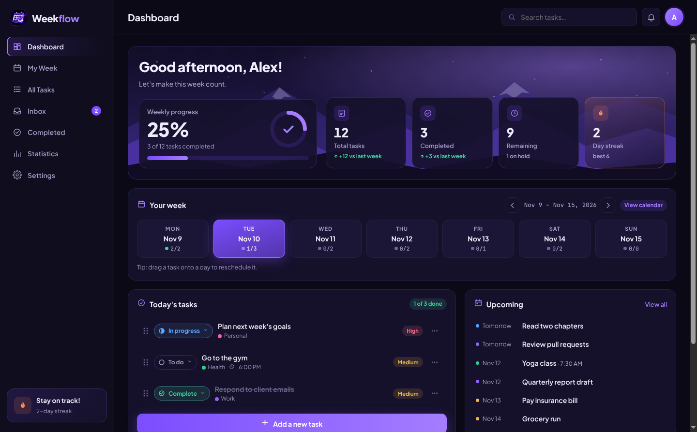
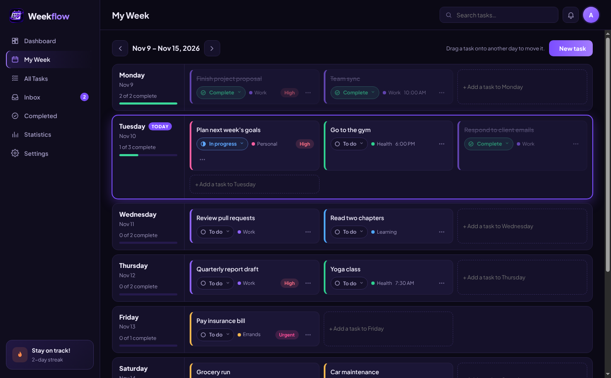
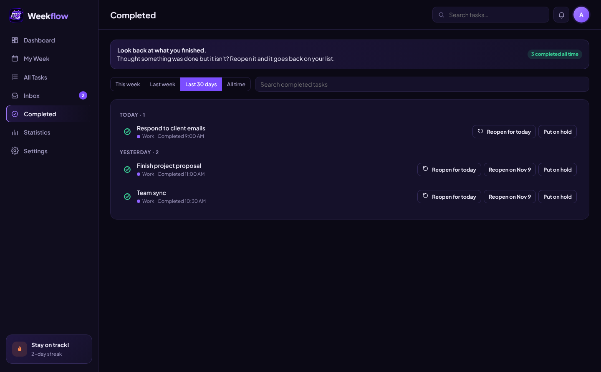
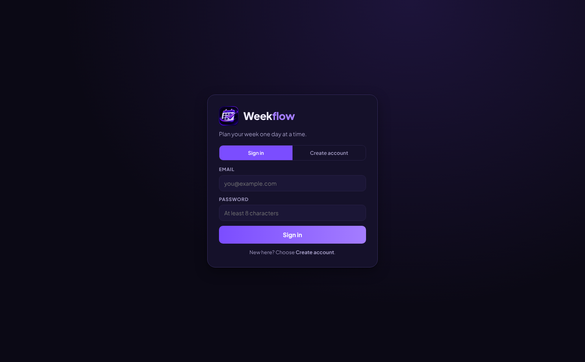

<p align="center">
  
</p>

<h1 align="center">WeekFlow</h1>

<p align="center">
  <b>Plan your week one day at a time.</b><br>
  A weekly planner for Windows, Linux and the web. Plan Monday to Sunday, track where every task stands, roll over unfinished work, and keep your streak going.
</p>

<p align="center">
  <a href="https://github.com/jkowalski1216/weekflow-release/releases/latest/download/WeekFlow-Setup.exe"><b>⬇ Download for Windows</b></a>
  &nbsp;·&nbsp;
  <a href="#weekflow-on-the-web-host-it-yourself"><b>🌐 Run the web app</b></a>
  &nbsp;·&nbsp;
  <a href="https://github.com/jkowalski1216/weekflow-release/releases/latest/download/WeekFlow-x86_64.AppImage"><b>⬇ Download for Linux (AppImage)</b></a>
  &nbsp;·&nbsp;
  <a href="https://github.com/jkowalski1216/weekflow-release/releases/latest/download/weekflow_amd64.deb"><b>⬇ Download for Ubuntu / Debian (.deb)</b></a>
</p>

<p align="center">
  <a href="https://github.com/jkowalski1216/weekflow-release/releases/latest"></a>
  
  
</p>



---

## Contents

- [Download](#download)
- [Install on Windows](#install-on-windows)
- [Install on Linux](#install-on-linux)
- [WeekFlow on the web (host it yourself)](#weekflow-on-the-web-host-it-yourself)
- [What WeekFlow does](#what-weekflow-does)
- [Getting started](#getting-started)
- [Keyboard shortcuts](#keyboard-shortcuts)
- [Updates](#updates)
- [Your data and privacy](#your-data-and-privacy)
- [Troubleshooting](#troubleshooting)
- [Project layout and development](#project-layout-and-development)
- [Release history](#release-history)

---

## Download

| System | File | Size | Updates itself? |
| --- | --- | --- | --- |
| **Windows 10 or 11** (64-bit) | [WeekFlow-Setup.exe](https://github.com/jkowalski1216/weekflow-release/releases/latest/download/WeekFlow-Setup.exe) | ~107 MB | Yes |
| **Any Linux** (64-bit) | [WeekFlow-x86_64.AppImage](https://github.com/jkowalski1216/weekflow-release/releases/latest/download/WeekFlow-x86_64.AppImage) | ~119 MB | Yes |
| **Ubuntu, Debian, Mint, Pop!_OS** (64-bit) | [weekflow_amd64.deb](https://github.com/jkowalski1216/weekflow-release/releases/latest/download/weekflow_amd64.deb) | ~95 MB | Download new versions from here |

These links always point to the newest version. Older versions are on the [Releases page](https://github.com/jkowalski1216/weekflow-release/releases).

---

## Install on Windows

1. Download **[WeekFlow-Setup.exe](https://github.com/jkowalski1216/weekflow-release/releases/latest/download/WeekFlow-Setup.exe)**.
2. Double-click it. WeekFlow installs for your user account (no admin rights needed) and opens on its own.
3. If Windows shows **"Windows protected your PC"**, click **More info → Run anyway**.
   This appears because WeekFlow isn't code-signed yet. It does not mean anything is wrong with the file.

WeekFlow adds itself to the Start menu and the desktop. To uninstall, open **Settings → Apps → Installed apps**, find **WeekFlow**, and choose **Uninstall**.

---

## Install on Linux

### Option A: AppImage (any distribution, updates itself)

```bash
# 1. Download
wget https://github.com/jkowalski1216/weekflow-release/releases/latest/download/WeekFlow-x86_64.AppImage

# 2. Make it runnable
chmod +x WeekFlow-x86_64.AppImage

# 3. Run it
./WeekFlow-x86_64.AppImage
```

You can also right-click the file in your file manager, open **Properties → Permissions**, tick **Allow executing file as program**, and double-click it.

> **"AppImages require FUSE to run"?** Install FUSE 2 once:
> Ubuntu 22.04 and newer: `sudo apt install libfuse2t64` (24.04) or `sudo apt install libfuse2` (22.04) · Fedora: `sudo dnf install fuse fuse-libs` · Arch: `sudo pacman -S fuse2`

Tip: keep the AppImage somewhere permanent, such as `~/Applications`, so updates can replace it in place.

### Option B: .deb package (Ubuntu, Debian and relatives)

```bash
wget https://github.com/jkowalski1216/weekflow-release/releases/latest/download/weekflow_amd64.deb
sudo apt install ./weekflow_amd64.deb
```

WeekFlow then appears in your app menu. Start it from the terminal with `weekflow`.
To update, download the new `.deb` and run the same `apt install` command. To remove it: `sudo apt remove weekflow`.

---

## What WeekFlow does

| Area | What you get |
| --- | --- |
| **Dashboard** | A greeting, weekly progress, total / completed / remaining counts, your day streak, the Mon–Sun strip, today's tasks, what's coming up, and quick actions. |
| **My Week** | Each day from Monday to Sunday is a wide row of task cards. Drag a card to another day to reschedule it. Unscheduled tasks wait in the Inbox row. |
| **All Tasks** | Search, filter by status, priority or category, and sort by day, priority or newest. |
| **Inbox** | Capture an idea in one line and give it a day later: Today, Tomorrow or Next week. |
| **Completed** | Look back through finished work by week, 30 days or all time. Reopen anything that turned out not to be done. |
| **Statistics** | An 8-week chart of planned vs. completed, progress by category, current and best streak, and completed history. |
| **Settings** | Your name, dark / light / system theme, reminders, categories, tray and startup options, updates, and backups. |

**Task status.** Every task is **To do**, **In progress**, **On hold** or **Complete**. Change it from the status button on any task. On-hold tasks stay put and don't send reminders.

**Built to keep the week moving**
- **Automatic rollover:** each morning, unfinished tasks from earlier days move to today.
- **Weekly reset:** every Monday the dashboard starts fresh and shows how last week went.
- **Recurring tasks:** daily, weekdays, weekly or monthly. Completing one schedules the next.
- **Priorities:** Low, Medium, High and Urgent.
- **Color-coded categories** that you can rename, recolor, add and remove.
- **Reminders:** a daily summary at a time you choose, plus a reminder at a task's own time.
- **Streaks:** how many days in a row you've completed at least one task.
- **Runs in the tray** (optional) so reminders still arrive with the window closed.



---

## Getting started

1. Open **Settings** and enter your name.
2. Press **N** or click **Add a new task**. Give it a day, a priority and a category.
3. Use the **Inbox** for anything that doesn't have a day yet.
4. Set each task's status as you work. Marking it **Complete** moves it to the **Completed** page.
5. Turn on **Daily summary** in Settings to get a morning notification with your plan.



---

## WeekFlow on the web (host it yourself)

The web version is the same WeekFlow in your browser, with accounts. Each person signs up with an email and password and sees only their own tasks. Tasks sync between every browser and device you sign in on.



**What it runs on:** one small Node.js server with a SQLite database file. Any Linux VM with 1 CPU and 512 MB of RAM is plenty. There is nothing to compile and no separate database server.

### Option A: install as a service on a Debian or Ubuntu VM (recommended)

```bash
git clone https://github.com/jkowalski1216/weekflow-release.git
cd weekflow-release
sudo bash deploy/install.sh
```

The script installs Node.js 22 if needed, copies WeekFlow to `/opt/weekflow`, keeps data in `/var/lib/weekflow`, and starts the `weekflow` service plus a nightly backup. When it finishes, it prints the address to open, for example `http://192.168.1.50:8080`.

| Task | Command |
| --- | --- |
| See if it's running | `systemctl status weekflow` |
| Live logs | `journalctl -u weekflow -f` |
| Change settings | `sudo nano /etc/weekflow.env`, then `sudo systemctl restart weekflow` |
| Update to the newest code | `git pull && sudo bash deploy/update.sh` |
| Back up now | `cd /opt/weekflow && sudo -u weekflow env $(cat /etc/weekflow.env \| xargs) node server/admin.js backup` |

### Option B: Docker

```bash
git clone https://github.com/jkowalski1216/weekflow-release.git
cd weekflow-release
cp .env.example .env        # optional: adjust settings
docker compose up -d
```

Then open `http://<vm-ip>:8080`. Data is kept in the `weekflow-data` volume.

### Settings

All settings live in `/etc/weekflow.env` (service) or `.env` (Docker / `npm start`). See [`.env.example`](.env.example).

| Setting | Default | What it does |
| --- | --- | --- |
| `PORT` | `8080` | Port WeekFlow listens on |
| `HOST` | `0.0.0.0` | Address to listen on. Use `127.0.0.1` behind a reverse proxy |
| `DATA_DIR` | `data` | Where the database and backups are stored |
| `ALLOW_SIGNUP` | `true` | Let people create accounts. Set to `false` once everyone has joined |
| `INVITE_CODE` | *(empty)* | If set, people need this code to sign up |
| `TRUST_PROXY` | `0` | Set to `1` when Caddy or nginx runs in front of WeekFlow |
| `SESSION_DAYS` | `30` | How long people stay signed in |

### HTTPS

Browsers only show reminders (notifications) on `https://` sites or on `localhost`. To get HTTPS, put [Caddy](https://caddyserver.com) in front of WeekFlow:

1. `sudo apt install caddy`
2. Edit [`deploy/Caddyfile`](deploy/Caddyfile) with your hostname, then `sudo cp deploy/Caddyfile /etc/caddy/Caddyfile && sudo systemctl reload caddy`
3. In `/etc/weekflow.env` set `HOST=127.0.0.1` and `TRUST_PROXY=1`, then `sudo systemctl restart weekflow`

For a lab-only hostname without public DNS, uncomment `tls internal` in the Caddyfile.

### Managing accounts

Run these on the VM from `/opt/weekflow` as the `weekflow` user (or `npm run admin -- <command>` in a development copy):

| Command | What it does |
| --- | --- |
| `node server/admin.js users` | List accounts and how many tasks each has |
| `node server/admin.js reset-password <email>` | Give someone a temporary password if they forgot theirs |
| `node server/admin.js delete-user <email>` | Remove an account and all its tasks |
| `node server/admin.js backup [file]` | Make a consistent copy of the database |

People can change their own password, sign out, export their tasks, and delete their account in **Settings → Account**.

### Moving tasks from the desktop app

In the desktop app, open **Settings → Export**. In the web app, open **Settings → Import** and choose that file. Tasks merge in, and nothing is deleted.

### Security

- Passwords are hashed with scrypt. Sessions are random tokens in HttpOnly, SameSite cookies, marked Secure over HTTPS.
- Every account's tasks are separated on the server. One person can never read or change another person's tasks.
- Sign-in and sign-up attempts are rate-limited. Writes require a same-site header and origin check.
- Strict security headers are on by default: Content-Security-Policy, no framing, no referrer leaks.

---

## Keyboard shortcuts

| Shortcut | Action |
| --- | --- |
| `N` | New task |
| `/` | Search tasks |
| `Ctrl` + `1`–`5` | Dashboard, My Week, All Tasks, Inbox, Statistics |
| `Ctrl` + `,` | Settings |
| `Ctrl` + `←` / `→` | Previous / next week |
| `Ctrl` + `T` | Jump to this week |
| `Ctrl` + `E` | Export a backup |
| `Ctrl` + `I` | Import a backup |
| `Esc` | Close a dialog or menu |

Press `Alt` to show the menu bar.

---

## Updates

The Windows app and the Linux AppImage check this page for a new version when they open and every few hours after that.

When there's a new version, a bar at the top of WeekFlow says so. Click **Download**, keep working, then click **Restart now**. Nothing downloads or installs until you click. You can also check any time from **Settings → Updates** or **Help → Check for Updates**. To stop the automatic checks, turn off **Check automatically** in Settings.

Updating keeps all your tasks and settings.

---

## Your data and privacy

**Desktop app**
- The desktop app has **no account and no cloud**. Your tasks are saved only on your own computer.
- Nobody else can see your tasks, including the person who made WeekFlow.
- The only thing WeekFlow sends over the internet is the update check to this GitHub page, and only while **Check automatically** is on.
- Back up any time from **Settings → Export**. This saves a `.json` file. Use **Import** to load it on another computer. Importing merges tasks in and never deletes anything.

**Web app:** tasks are stored in the database on the server where WeekFlow is hosted, under each person's own account. Whoever runs that server can see the database, so only use a WeekFlow server you trust.

Where the desktop app's data lives:

| System | Folder |
| --- | --- |
| Windows | `%APPDATA%\WeekFlow` |
| Linux | `~/.config/WeekFlow` |

---

## Troubleshooting

**Windows says "Windows protected your PC".** Click **More info → Run anyway**. This is the normal warning for apps that aren't code-signed yet.

**My antivirus quarantined the installer.** Some antivirus tools are cautious with new, unsigned apps. Restore the file from quarantine, or download it again from the link above.

**The window doesn't open, or opens slowly.** WeekFlow writes a short startup log to `startup.log` in the data folder listed above. Please include it if you report a problem.

**I want the GPU drawing back.** WeekFlow draws with the CPU by default because some graphics drivers freeze with GPU drawing. To turn it back on, start WeekFlow with `--gpu`.

**The Linux AppImage won't start.** Make sure it's executable (`chmod +x`) and that FUSE 2 is installed (see [Install on Linux](#install-on-linux)).

**Notifications don't appear.** On Windows, check **Settings → System → Notifications** and make sure WeekFlow is allowed. On Linux, your desktop needs a notification service, which GNOME, KDE and most others include.

Found a bug or have an idea? [Open an issue](https://github.com/jkowalski1216/weekflow-release/issues).

---

## Project layout and development

```
weekflow-release/
├── server/          Web backend: Express API, accounts, sync, SQLite (node:sqlite)
│   ├── server.js    HTTP server and API routes
│   ├── auth.js      Passwords, sessions, rate limits
│   ├── db.js        Database schema and migrations
│   ├── admin.js     Admin commands (users, reset-password, backup)
│   └── config.js    Settings from environment / .env
├── web/             Web frontend (plain HTML, CSS and JavaScript, no build step)
├── test/            API tests (npm test)
├── deploy/          install.sh, update.sh, systemd units, Caddyfile
├── desktop/         Windows and Linux desktop app (Electron)
├── docs/            Screenshots used in this README
├── Dockerfile
└── docker-compose.yml
```

**Run the web app locally** (Node.js 22.13 or newer):

```bash
npm install
npm run dev          # http://localhost:8080, restarts on changes
npm test             # API tests
```

**Build the desktop app** (from `desktop/`):

```bash
cd desktop
npm install
npx electron-builder --win --x64     # Windows installer (needs Wine on Linux)
npx electron-builder --linux --x64   # AppImage and .deb
```

Upload the files from `desktop/dist/` to a new GitHub release (tag `vX.Y.Z`), including `latest.yml` and `latest-linux.yml`, and installed copies will offer the update.

---

## Release history

### Web app 1.0 (November 2026)
- **New:** WeekFlow in the browser, with sign-up and sign-in, a separate private task list for each person, and sync across devices.
- Self-host on any Linux VM with `deploy/install.sh` or Docker.

### WeekFlow 1.1 (November 2026)
- **New:** Linux support, as an AppImage and a .deb package.
- **New:** built-in updates from this page, with Download and Restart controls.
- **New:** task statuses (To do, In progress, On hold, Complete) replace the done checkbox.
- **New:** Completed page. Browse finished work and reopen anything that isn't really done.
- **New:** My Week shows each day as a wide, easy-to-read row.
- **Fixed:** a freeze on first launch with some graphics drivers.
- Smaller, one-click Windows installer.

### WeekFlow 1.0 (November 2026)
- First release: dashboard, My Week, All Tasks, Inbox, Statistics, Settings, recurring tasks, priorities, categories, rollover, reminders, streaks, and light and dark themes.

---

<p align="center"><sub>WeekFlow · Made by <a href="https://github.com/jkowalski1216">@jkowalski1216</a></sub></p>
